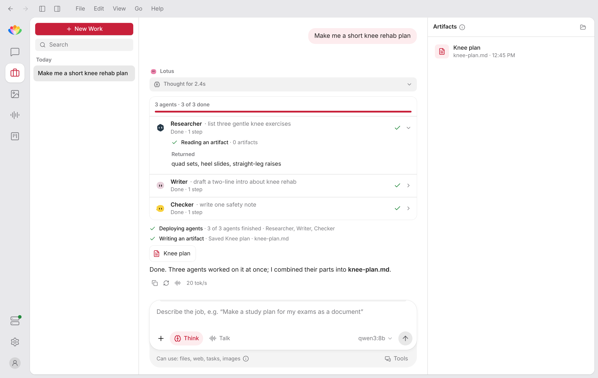
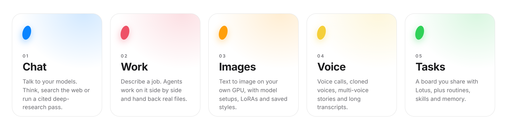
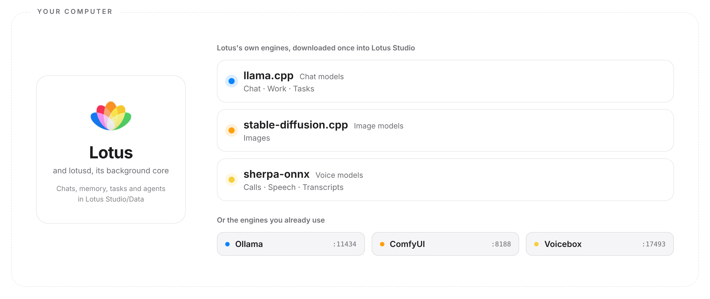

<a name="top"></a>

<div align="center">

<picture>
  <source media="(prefers-color-scheme: dark)" srcset="docs/assets/hero-dark.png">
  
</picture>

### Your local AI, in one calm window.

Chat, agents that get work done, images and voice for Windows, macOS and Linux,<br>
running entirely on models that live on your own computer.

<br>

[**Features**](#features) &nbsp;·&nbsp;
[**How it works**](#how-it-works) &nbsp;·&nbsp;
[**Get started**](#get-started) &nbsp;·&nbsp;
[**Privacy**](#privacy) &nbsp;·&nbsp;
[**Build from source**](#build-from-source)

<br>


<br>

<picture>
  <source media="(prefers-color-scheme: dark)" srcset="docs/assets/showcase-dark.png">
  
</picture>

</div>

<br>

Lotus is a small desktop app that brings everything you do with local AI into one place. It comes with its own engines, so there is nothing else to install: pick a chat, an image and a voice model in the setup guide and start. If you already use **Ollama**, **ComfyUI** or **Voicebox**, Lotus can drive those instead.

No accounts. No cloud. No telemetry. Turn off your Wi-Fi and it keeps working.

> [!NOTE]
> **Lotus is an early preview.** Every feature below exists in the code, and builds are published for Windows, macOS and Linux. Expect rough edges.

<br>

<a name="features"></a>

##  Five petals, five pages

Each petal of the logo is a page, and each page wears its petal's colour.

<picture>
  <source media="(prefers-color-scheme: dark)" srcset="docs/assets/petals-dark.png">
  
</picture>

###  Chat

Streaming conversations with any local model, with images, documents and whole folders as context.

- **Tools.** Ask in plain words and Lotus does it: read and save files in folders you allow, add tasks, routines and to-do lists, search the web, remember things. Each step shows in the reply with its real result, and a reply that claims something no step did is marked as such. Choose what needs asking in Settings → Tools.
- **Images from a chat.** Ask for a picture and Lotus suggests a prompt and settings for one of your image models; press *Yes, Create It* and it is made on the Images page.
- **Attachments.** Paste or drop any number of files: images, PDFs, Word, Excel, PowerPoint, OpenDocument, EPUB, RTF, HTML and text. Everything is read on your computer.
- **Think** works through a problem before answering. **Web** searches the live web and reads the top pages, only when you turn it on.
- **Research** turns a question into an editable plan, sends parallel agents through public academic databases, and writes a report where every citation links to a source it actually read.
- **Memory** recalls past chats and facts you've shared, and learns reusable **skills**. One click pauses it for a chat; Incognito switches it off entirely.
- Projects group related chats. Replies render clean Markdown with tables, code and checklists; code opens in a side panel where you can edit, copy or preview it.

###  Work

Describe a job and Lotus gets it done, handing back real files.

- It writes a **plan** you can follow step by step, and asks you when it needs a decision.
- For independent parts it **deploys agents** on its own (up to six, three at once), each with its own small face, task and progress bar, in the reply and on the island.
- Results are **artifacts**: documents, tables, web pages, drawings and code, saved in `Lotus Studio/Work` and shown in the side panel.
- **Think** shows its reasoning; **Talk** lets you give the job by voice and hear the answer. Copy, try again or edit any request.
- Optional: let Lotus use your **computer** or a **Chrome** window to finish a job. Both are off by default and every click or keystroke asks first.

###  Images

Text to image and image to image on your own GPU.

- Pick a model, an aspect ratio, a resolution and how many images per run, or start from an example prompt.
- Each model is kept with the exact VAE and text encoders it needs, so SD 1.5, SDXL, SD 3.5, FLUX and Qwen-Image models have everything they need.
- Paste or drop reference images, stack **LoRAs**, save prompt styles and recall them with `@`.
- Every generation gets its own folder in `Lotus Studio/Images`, with `Reference 1, 2…` and `Output 1, 2…` inside.
- With ComfyUI you also get inpaint, outpaint and upscale.

###  Voice

Everything voice, with Lotus's own engine and no extra install.

- **Call** your model and talk out loud. It answers as it writes, you can interrupt it, and it can remember the call afterwards.
- **Speak** any length of text in any voice, with effects and presets. **Voices** copies a voice from 5 to 15 seconds of speech, or tunes a built-in speaker.
- **Stories** turns a whole text into one line per paragraph, with several voices on a timeline you can play and export.
- **Speech to Text** writes down recordings of any length, audio or video, in the language they were spoken. Translate the transcript, save it as text or subtitles, or open it in Chat for a summary.

###  Tasks

Everything Lotus does on its own, and everything it has learned.

- **Board.** Assign a card to Lotus and its agent plans the steps, works through them and leaves the result in Review. Cards can block each other, so work happens in order.
- **Routines** run on a schedule while Lotus is open, and can catch up on runs they missed.
- **Skills**, **Memory**, **Soul** (the instructions that shape Lotus's personality) and **Plugins** each have their own tab. Read, edit or delete anything.

<br>

### And around the edges

<table>
<tr>
<td width="50%" valign="top">

**Floating island**<br>
<sub>A small black island at the top of the screen, like a Dynamic Island. It shows running agents and jobs, opens for quick questions, and lets you answer Lotus or approve a coding agent's requests. Off until you turn it on.</sub>

</td>
<td width="50%" valign="top">

**One home for models**<br>
<sub>Chat, image and voice models in one catalog, with what fits your graphics card marked. Add any model from Hugging Face. Everything, engines included, lives in your Lotus Studio folder.</sub>

</td>
</tr>
<tr>
<td width="50%" valign="top">

**Fits your GPU**<br>
<sub>Lotus checks free video memory every few seconds and sizes the context window, file chunks and number of background agents to match. Your profile shows usage over time and live hardware readings.</sub>

</td>
<td width="50%" valign="top">

**Looks at home on every system**<br>
<sub>Native menus and window buttons on macOS, Windows and Linux. Follows your system's light or dark setting, and both side panels fold away from the title bar.</sub>

</td>
</tr>
</table>

<div align="right"><sub><a href="#top">Back to top ↑</a></sub></div>

<a name="how-it-works"></a>

##  How it works

Lotus runs your models on your own computer and talks to every engine over its loopback address. Your prompts, images, voices and chats never leave that box.

<picture>
  <source media="(prefers-color-scheme: dark)" srcset="docs/assets/engines-dark.png">
  
</picture>

You don't have to install any of them. Lotus has its own engines (llama.cpp for chat, stable-diffusion.cpp for images, sherpa-onnx for voice and dictation), downloaded once from each project's GitHub releases into your Lotus Studio folder. Ollama, ComfyUI and Voicebox stay available in Settings → Engines if you already use them. A page whose engine or model is missing tells you so and offers to get it. Lotus never pretends.

Everything Lotus keeps lives in the **Lotus Studio** folder (Documents by default): `Data` (chats, settings, memory), `Engines`, `Models` (chat, image and voice models, one place for every engine), `Images`, `Audio` and `Work`. An image model is kept with the exact VAE and text encoders it needs (Models → Image Setups).

Behind the window runs **lotusd**, Lotus's background core. It keeps your chats, settings, tasks, memory and skills in one database file (`lotus.db` in the Lotus data folder) and saves generated images as ordinary files in `Lotus Studio/Images`, so they survive restarts and you can open them yourself. It also runs the agent: the model's tool calls go through it, so a task added from Chat lands on the Tasks board and an image made from Chat appears on the Images page. It starts and stops with Lotus and only listens on your own computer.

<div align="right"><sub><a href="#top">Back to top ↑</a></sub></div>

<a name="get-started"></a>

##  Get started

**1. Install Lotus.**<br>
Grab the file for your system from the [latest release](https://github.com/filipesilva0/Lotus/releases/latest):

| File | What it is |
|---|---|
| **`Lotus-windows-x64.msi`** | Windows installer, no admin rights needed. Installs to **Documents\Lotus Studio** (you can change it), asks which engines you want, and offers a desktop shortcut, start with Windows and portable data. |
| **`Lotus-windows-x64-portable.zip`** | Windows, portable. Unzip anywhere, even a USB stick. Everything stays in a `data` folder next to the app. |
| **`Lotus-macos-universal.dmg`** | macOS 11 or later, Apple silicon and Intel. Not notarized yet: the first time, right-click Lotus → *Open*. |
| **`Lotus-linux-x86_64.AppImage`** | Linux, any distribution with WebKitGTK 4.1. `chmod +x` it and run. |
| **`Lotus-linux-amd64.deb`** / **`Lotus-linux-x86_64.rpm`** | Linux packages for Debian/Ubuntu and Fedora/openSUSE. |

Installed copies update themselves from **Settings → Updates** (the portable zip and the .deb/.rpm are replaced by downloading the new file).

**2. Follow the setup guide.**<br>
The first time Lotus opens, a short guide picks your **Lotus Studio** folder (in Documents) and asks how Lotus should run your models: with its own engines (nothing else to install), or with **Ollama**, **ComfyUI** and **Voicebox** if you already use them. Then it suggests a chat, an image and a voice model picked for your graphics card. Reopen it any time from **Help → Setup Guide**.

**3. Start.**<br>
Models download in the background. Everything else lives in **Engines & Models**.

<details>
<summary><b>Keyboard shortcuts</b></summary>
<br>

| Shortcut | Action |
|---|---|
| <kbd>Ctrl</kbd> <kbd>Alt</kbd> <kbd>Space</kbd> | Open the island chat |
| <kbd>Ctrl</kbd> <kbd>Alt</kbd> <kbd>D</kbd> | Start or stop dictation |
| <kbd>Ctrl</kbd> <kbd>Alt</kbd> <kbd>T</kbd> | Show or hide the island |
| <kbd>Ctrl</kbd> <kbd>Alt</kbd> <kbd>S</kbd> | Show or hide the left panel |
| <kbd>Ctrl</kbd> <kbd>Alt</kbd> <kbd>I</kbd> | Show or hide the right panel |

</details>

<details>
<summary><b>System requirements</b></summary>
<br>

- Windows 10 (version 1803 or later) or Windows 11, 64-bit; macOS 11 Big Sur or later; or a 64-bit Linux desktop with WebKitGTK 4.1 (Ubuntu 22.04, Fedora 36, Debian 12 or newer).
- On macOS the shortcuts use <kbd>Control</kbd> <kbd>Option</kbd> instead of <kbd>Ctrl</kbd> <kbd>Alt</kbd>.
- A GPU is strongly recommended. For chat, a 7B model or larger works best; Work and its agents want a model that handles tools well (8B or larger).
- Lotus itself is small. The models you download are not, so leave room for them.

</details>

<div align="right"><sub><a href="#top">Back to top ↑</a></sub></div>

<a name="privacy"></a>

##  Privacy

Lotus is local-first by design. Nothing leaves your computer unless you switch it on.

The setup guide and the Models page download only what you pick, and only from each project's own site: Lotus's engines from github.com (llama.cpp, stable-diffusion.cpp and sherpa-onnx releases, found through api.github.com), outside engine installers from github.com (Ollama, Voicebox) and download.comfy.org (ComfyUI), and models from huggingface.co (chat GGUFs, image models), github.com (sherpa-onnx voice and Whisper models), ollama.com and Voicebox's own sources.

| What | When it goes online | What is sent |
|---|---|---|
| Chat, Work and its agents, images, voice, memory, tasks | Never | Nothing. All of it stays on your computer. |
| **Engines on another computer** | Only if you set an engine's address to another computer (Engines → Change, or the setup guide) | Your chats (including any memory Lotus adds to a prompt), image prompts and voice requests go to *that* engine, on the computer you named. An access key you enter is sent only to that engine. |
| **Web** in chat | Only when you turn it on | Your question to the search service you pick, then a request to each top result page |
| **Chrome control** in Work | Only when you turn it on in Settings → Tools, and each action asks first | Whatever the pages Lotus opens for you would receive from any browser |
| **Deep Research** | Only during a research run | Short keyword queries to the academic databases you tick |
| **Engine and model downloads** | Only when you pick them in the setup guide or press *Get* / *Download* | A request to that project's own site (see above) or the link you pasted |
| **Update check** | When you press the button, or at launch if you opt in | A request to this repository's Releases |

No telemetry, no analytics, no remote fonts. Your chats, settings, tasks and memory live in a single file in `Lotus Studio/Data` (`lotus.db`), images in `Lotus Studio/Images`, and skills are plain files you can open and edit. Lotus's background core (lotusd) listens only on `127.0.0.1`, on a port picked at each start, and answers only Lotus's own windows (each run gets a new random key). The full list of hosts is in [`THIRD_PARTY_LICENSES.md`](THIRD_PARTY_LICENSES.md).

<div align="right"><sub><a href="#top">Back to top ↑</a></sub></div>

<a name="build-from-source"></a>

##  Build from source

You'll need **Node 22+**, **Rust** (stable) and **[Bun](https://bun.sh) 1.4+** (it compiles lotusd, the background core, into one file). On Windows use the MSVC toolchain; on Linux first install `libwebkit2gtk-4.1-dev libappindicator3-dev librsvg2-dev patchelf libxdo-dev`; on macOS the Xcode command line tools.

```powershell
npm install
cd core; bun install; bun scripts/build.ts; cd ..   # build lotusd for this computer (once, and after core changes)
npm run tauri:dev                  # run with hot reload
npm run tauri:build                # MSI on Windows, .app/.dmg on macOS, AppImage/.deb/.rpm on Linux
./scripts/package-portable.ps1     # Windows only: then build the portable zip
```

**Releases.** `.github/workflows/build-windows.yml` builds all three systems on hosted runners. In the Actions tab choose *Build and release* → *Run workflow* and type a version (such as `0.2.0`) to publish a signed release with `latest.json`, which installed copies update from; leave the version empty for a test build. Pushing a `v*` tag does the same. Publishing needs the repository secret `TAURI_SIGNING_PRIVATE_KEY` (the private half of the public key in `src-tauri/tauri.conf.json`).

<details>
<summary><b>Project layout</b></summary>
<br>

```
src/                 The interface
  components/        Pages, panels and shared controls
  island/            The floating island (its own window)
  services/          Clients for Ollama, ComfyUI and Voicebox
core/                lotusd, the background core: lotus.db, media files, memory (TypeScript, Bun)
src-tauri/           The native shell: windows, tray, shortcuts, engine launcher, starts lotusd
  wix/               Installer template
```

</details>

<details>
<summary><b>Checks to run before a change</b></summary>
<br>

```bash
npx tsc --noEmit                          # type-check
npm run build                             # build the interface
npm run check:tauri                       # native and web package versions match
(cd core && bun test)                     # core tests
```

</details>

<div align="right"><sub><a href="#top">Back to top ↑</a></sub></div>

<a name="license"></a>

##  License

A license for Lotus hasn't been chosen yet. Until one is added in `LICENSE`, all rights are reserved. Engines and bundled fonts keep their own licenses; see [`THIRD_PARTY_LICENSES.md`](THIRD_PARTY_LICENSES.md).

<br>

<div align="center">

<br>
<sub>Made for people who'd rather keep their AI at home.</sub>
</div>
