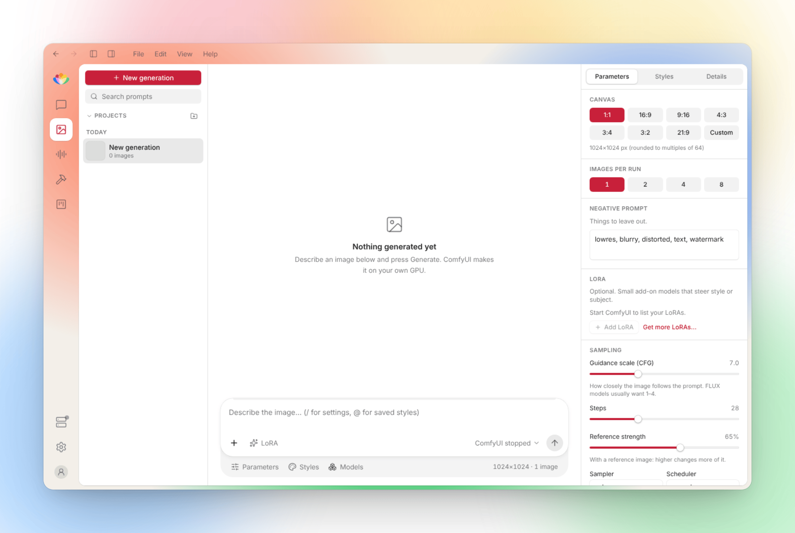
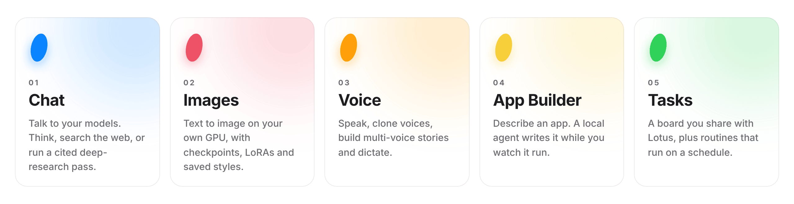
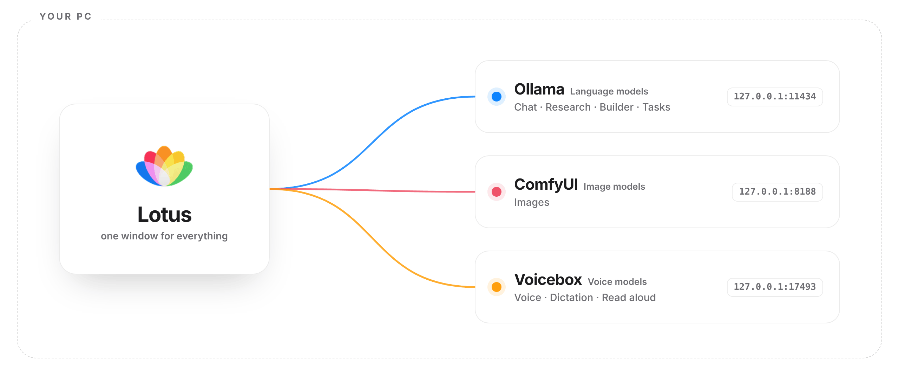

<a name="top"></a>

<div align="center">

<picture>
  <source media="(prefers-color-scheme: dark)" srcset="docs/assets/hero-dark.png">
  
</picture>

### Your local AI, in one calm window.

Chat, images, voice, research and an app builder for Windows, macOS and Linux,<br>
running entirely on models that live on your own PC.

<br>

[**Features**](#features) &nbsp;·&nbsp;
[**How it works**](#how-it-works) &nbsp;·&nbsp;
[**Get started**](#get-started) &nbsp;·&nbsp;
[**Privacy**](#privacy) &nbsp;·&nbsp;
[**Build from source**](#build-from-source)

<br>


<br>

<picture>
  <source media="(prefers-color-scheme: dark)" srcset="docs/assets/showcase-dark.png">
  
</picture>

</div>

<br>

Lotus is a small desktop app that brings everything you do with local AI into one place. It doesn't run models itself. It sits in front of three engines you already know, **Ollama**, **ComfyUI** and **Voicebox**, and gives them one consistent, quiet interface.

No accounts. No cloud. No telemetry. Turn off your Wi-Fi and it keeps working.

> [!NOTE]
> **Lotus is an early preview.** Every feature below exists in the code, and builds are published for Windows, macOS and Linux. Expect rough edges.

<br>

<a name="features"></a>

##  Five petals, five pages

Each petal of the logo is a page, and each page wears its petal's colour.

<picture>
  <source media="(prefers-color-scheme: dark)" srcset="docs/assets/petals-dark.png">
  
</picture>

###  Chat

Streaming conversations with any model in Ollama, with images, files and whole folders as context.

- **Think** works through a problem in passes: analyse, draft, check.
- **Web** searches the live web and reads the top pages, only when you turn it on.
- **Deep Research** turns a question into an editable plan, sends parallel agents through public academic databases, and writes a report where every citation links to a source it actually read.
- **Memory** recalls past chats and facts you've shared, and learns reusable **skills** from complex work. One click pauses it for a chat; Incognito switches it off entirely.
- Replies render clean Markdown with tables, code and checklists. Code opens in a side panel where you can edit, copy or preview it.

###  Images

Text to image through ComfyUI, on your own GPU.

- Pick a checkpoint, an aspect ratio and how many images per run.
- Stack up to four **LoRAs**, each with its own strength.
- Save prompt styles and recall them with `@`.
- Download new checkpoints and LoRAs from a link, straight into the right folder.

###  Voice

A full second front end for Voicebox, sharing its voices and history.

- **Speak** in 23 languages with delivery instructions, seeds and an effects chain.
- **Clone** a voice from a short recording, or describe one in words.
- **Stories** puts several voices on a timeline you can trim, split, retime and export.
- **Dictate** transcribes locally, then copies, speaks or sends the text to chat.

###  App Builder

Describe an app and watch a local agent build it.

- With **Plan first**, the agent proposes a checklist you edit and approve before it writes a line.
- Every file change and command is shown as it happens. Commands ask before they run.
- A built-in preview reloads as files change, with phone and tablet frames.
- Start from a template: website, web app, installable phone app, desktop app or mobile app.

###  Tasks

A board you share with Lotus.

- Assign a card to Lotus and its agent plans the steps, works through them and leaves the result in **Review**.
- Cards can block each other, so work happens in the right order.
- **Routines** run on a schedule while Lotus is open, and can catch up on runs they missed.
- The **Skills** library shows everything Lotus has learned, with full history. Edit or delete anything.

<br>

### And around the edges

<table>
<tr>
<td width="50%" valign="top">

**Floating island**<br>
<sub>An always-on-top pill for quick chat, dictation, reading the clipboard aloud and dropping in files. It also shows background activity and lets you approve or deny a coding agent's permission requests from your terminal.</sub>

</td>
<td width="50%" valign="top">

**Fits your GPU**<br>
<sub>Lotus checks free video memory every few seconds and sizes the context window, file chunks, model choice and number of background agents to match, so nothing runs out of memory.</sub>

</td>
</tr>
<tr>
<td width="50%" valign="top">

**One home for models**<br>
<sub>Language, image, LoRA and voice models in one list. Pull any model by name, compare models in the Arena, and watch your hardware in the Monitor.</sub>

</td>
<td width="50%" valign="top">

**Light, dark or automatic**<br>
<sub>Follows your system's light or dark setting, or set it yourself. Both side panels fold away from the title bar when you want the space.</sub>

</td>
</tr>
</table>

<div align="right"><sub><a href="#top">Back to top ↑</a></sub></div>

<a name="how-it-works"></a>

##  How it works

Lotus talks to each engine over your own machine's loopback address. Your prompts, images, voices and chats never leave that box.

<picture>
  <source media="(prefers-color-scheme: dark)" srcset="docs/assets/engines-dark.png">
  
</picture>

Install only the engines you want. A page whose engine isn't running tells you so and offers to start it. Lotus never pretends.

<div align="right"><sub><a href="#top">Back to top ↑</a></sub></div>

<a name="get-started"></a>

##  Get started

**1. Install the engines you want.**<br>
**Ollama** for chat, research, the App Builder and tasks. **ComfyUI** for images. **Voicebox** for voice.

**2. Install Lotus.**<br>
Grab the file for your system from the [latest release](https://github.com/filipesilva0/Lotus/releases/latest):

| File | What it is |
|---|---|
| **`Lotus-windows-x64.msi`** | Windows installer. Choose *Just for me* (no admin rights) or *All users*, the install folder, and optional extras: a desktop shortcut, start with Windows, and portable data. |
| **`Lotus-windows-x64-portable.zip`** | Windows, portable. Unzip anywhere, even a USB stick. Everything stays in a `data` folder next to the app. |
| **`Lotus-macos-universal.dmg`** | macOS 11 or later, Apple silicon and Intel. Not notarized yet: the first time, right-click Lotus → *Open*. |
| **`Lotus-linux-x86_64.AppImage`** | Linux, any distribution with WebKitGTK 4.1. `chmod +x` it and run. |
| **`Lotus-linux-amd64.deb`** / **`Lotus-linux-x86_64.rpm`** | Linux packages for Debian/Ubuntu and Fedora/openSUSE. |

Installed copies update themselves from **Settings → Updates** (the portable zip and the .deb/.rpm are replaced by downloading the new file).

**3. Open Engines.**<br>
Lotus finds Ollama by itself. Point it once at the file you use to launch ComfyUI and at Voicebox's server, then press *Start*. Turn on *Start with Lotus* and you won't think about it again.

**4. Get a model.**<br>
Open **Models**, type any model name, such as `qwen2.5:7b`, and download it. You're ready.

<details>
<summary><b>Keyboard shortcuts</b></summary>
<br>

| Shortcut | Action |
|---|---|
| <kbd>Ctrl</kbd> <kbd>Alt</kbd> <kbd>Space</kbd> | Open the island chat |
| <kbd>Ctrl</kbd> <kbd>Alt</kbd> <kbd>D</kbd> | Start or stop dictation |
| <kbd>Ctrl</kbd> <kbd>Alt</kbd> <kbd>T</kbd> | Show or hide the island |
| <kbd>Ctrl</kbd> <kbd>Alt</kbd> <kbd>S</kbd> | Show or hide the left panel |
| <kbd>Ctrl</kbd> <kbd>Alt</kbd> <kbd>I</kbd> | Show or hide the right panel |

</details>

<details>
<summary><b>System requirements</b></summary>
<br>

- Windows 10 (version 1803 or later) or Windows 11, 64-bit; macOS 11 Big Sur or later; or a 64-bit Linux desktop with WebKitGTK 4.1 (Ubuntu 22.04, Fedora 36, Debian 12 or newer).
- On macOS the shortcuts use <kbd>Control</kbd> <kbd>Option</kbd> instead of <kbd>Ctrl</kbd> <kbd>Alt</kbd>.
- A GPU is strongly recommended. For chat, a 7B model or larger works best. The App Builder wants a code-tuned model with at least a 16K context.
- Lotus itself is small. The models you download are not, so leave room for them.

</details>

<div align="right"><sub><a href="#top">Back to top ↑</a></sub></div>

<a name="privacy"></a>

##  Privacy

Lotus is local-first by design. Nothing leaves your PC unless you switch it on.

| What | When it goes online | What is sent |
|---|---|---|
| Chat, images, voice, memory, tasks | Never | Nothing. All of it stays on your PC. |
| **Web** in chat | Only when you turn it on | Your question to the search service you pick, then a request to each top result page |
| **Deep Research** | Only during a research run | Short keyword queries to the academic databases you tick |
| **Model downloads** | Only when you press *Download* | A request to the link you pasted |
| **Update check** | When you press the button, or at launch if you opt in | A request to this repository's Releases |

No telemetry, no analytics, no remote fonts. Memory lives in a single file in your Lotus data folder, and skills are plain files you can open and edit. The full list of hosts is in [`THIRD_PARTY_LICENSES.md`](THIRD_PARTY_LICENSES.md).

<div align="right"><sub><a href="#top">Back to top ↑</a></sub></div>

<a name="build-from-source"></a>

##  Build from source

You'll need **Node 22+** and **Rust** (stable). On Windows use the MSVC toolchain; on Linux first install `libwebkit2gtk-4.1-dev libappindicator3-dev librsvg2-dev patchelf libxdo-dev`; on macOS the Xcode command line tools.

```powershell
npm install
npm run tauri:dev                  # run with hot reload
npm run tauri:build                # MSI on Windows, .app/.dmg on macOS, AppImage/.deb/.rpm on Linux
./scripts/package-portable.ps1     # Windows only: then build the portable zip
```

**Releases.** `.github/workflows/build-windows.yml` builds all three systems on hosted runners. In the Actions tab choose *Build and release* → *Run workflow* and type a version (such as `0.2.0`) to publish a signed release with `latest.json`, which installed copies update from; leave the version empty for a test build. Pushing a `v*` tag does the same. Publishing needs the repository secret `TAURI_SIGNING_PRIVATE_KEY` (the private half of the public key in `src-tauri/tauri.conf.json`).

<details>
<summary><b>Project layout</b></summary>
<br>

```
src/                 The interface
  components/        Pages, panels and shared controls
  island/            The floating island (its own window)
  services/          Clients for Ollama, ComfyUI and Voicebox
src-tauri/           The native shell: windows, tray, shortcuts, engine launcher
  wix/               Installer template
handover/            Test harnesses and screenshot scripts
```

</details>

<details>
<summary><b>Checks to run before a change</b></summary>
<br>

```bash
npx tsc --noEmit                          # type-check
npm run build                             # build the interface
npm run check:tauri                       # native and web package versions match
bash handover/verification/run-tests.sh   # test suite
```

Maintainer notes, project history and known issues live in `CURRENT_STATE.md`, `TASKS.md`, `ARCHITECTURE.md` and `DECISIONS.md`.

</details>

<div align="right"><sub><a href="#top">Back to top ↑</a></sub></div>

<a name="license"></a>

##  License

A license for Lotus hasn't been chosen yet. Until one is added in `LICENSE`, all rights are reserved. Engines and bundled fonts keep their own licenses; see [`THIRD_PARTY_LICENSES.md`](THIRD_PARTY_LICENSES.md).

<br>

<div align="center">

<br>
<sub>Made for people who'd rather keep their AI at home.</sub>
</div>
